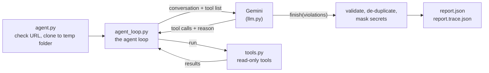

# DevOps Repository Auditing Agent

An AI agent that inspects a public GitHub repository on its own, finds DevOps best-practice
violations, and writes an evidence-based JSON report with fixes.

It uses **Google Gemini** (the free API key works) and a **hand-written agent loop** in plain
Python. No LangChain, LangGraph, n8n or other agent framework is used; the only AI library is
Google's basic SDK (`google-genai`), with its automatic function calling turned off.

## How it works



The agent cycle is **Observe → Reason → Select tool → Execute → Interpret → Report**:

1. **Observe**: `agent.py` clones the repository into a temporary folder and starts the loop.
   Gemini begins by calling `list_files` and `git_log`.
2. **Reason + Select tool**: Gemini answers with the tools it wants next, each with a
   `reason` ("the workflow runs pytest, checking whether failures are ignored").
3. **Execute**: `agent_loop.py` runs those tools (`tools.py`). Several can run in one turn.
4. **Interpret**: the results go back to Gemini, which decides the follow-up (a search hit →
   read that file; a "remove secret" commit → search the history). Nothing is a fixed checklist:
   what gets opened depends on what the agent has seen.
5. **Report**: when every area is checked, Gemini calls `finish(violations)`. The loop
   validates each finding, removes duplicates, masks secrets and writes the JSON.

If the step budget runs out, the last turn forces a `finish` call, so a run always ends with a report.

| File | Job |
|---|---|
| `agent.py` | CLI entry point: arguments, URL check, cloning, writing the JSON files |
| `agent_loop.py` | The agent loop, step budget, `finish` tool, report validation |
| `llm.py` | Gemini connection: tool declarations, conversation history, retries |
| `prompt.py` | Instructions for Gemini: what to check, evidence rules, severities, rule ids |
| `tools.py` | The inspection tools and secret masking |
| `tests/` | Automated tests with a fake LLM (no API key needed) |

### Tools

| Tool | What it does |
|---|---|
| `list_files(directory)` | Lists committed files (`git ls-files`); large repos are summarised by folder |
| `read_file(path, start_line)` | Shows a file with line numbers, 200 lines per call |
| `search_code(pattern, file_glob)` | Case-insensitive regex search across committed files |
| `git_log(max_count)` | Recent commits with changed files, plus the default branch name |
| `search_history(pattern)` | Lines added or removed in past commits (finds deleted secrets) |
| `run_ruff()` | Static check for syntax errors and undefined names (never runs the code) |
| `finish(violations)` | Gemini submits the final report |

### What it checks

Repository hygiene, dependency management, code quality, testing, GitHub Actions / CI, security,
configuration, collaboration, and build/release. `prompt.py` lists the concrete checks, the
"acceptable alternatives" that must **not** be reported (for example `pyproject.toml` instead of
`requirements.txt`, or placeholder values in `.env.example`), the severity scale and the rule ids.

## Setup

You need **Python 3.10+**, **Git**, and a free Gemini API key from <https://aistudio.google.com/apikey>.

```bash
git clone https://github.com/aimennnnn/devops-audit-agent.git
cd devops-audit-agent
python -m venv .venv
```

Activate the virtual environment:

- Windows (PowerShell): `.venv\Scripts\Activate.ps1`
- macOS / Linux: `source .venv/bin/activate`

Install and configure:

```bash
pip install -r requirements.txt
```

- Windows: `copy .env.example .env`
- macOS / Linux: `cp .env.example .env`

Open `.env` and paste your key after `GEMINI_API_KEY=`. `GEMINI_MODEL` is optional
(default `gemini-3.6-flash`; `gemini-3.8-flash` also works on the free tier).

## Run

```bash
python agent.py --repo https://github.com/owner/repo --output report.json
```

- `report.json`: the report (format below).
- `report.trace.json`: every tool call with the agent's reason and a preview of the result.
- The console shows each step live, then a summary table.
- Exit code `0` = inspection finished (an empty `violations` list means nothing was found).
  Exit code `1` = fatal error (bad URL, clone failed, API problem) with a message.
- Optional: `--max-steps 20` limits the number of agent turns.

A local git folder can also be passed to `--repo` for testing.

## Output format

```json
{
  "repository": "https://github.com/example/demo-project",
  "violations": [
    {
      "rule_id": "SEC-001",
      "category": "security",
      "severity": "critical",
      "file": "config.py",
      "line": 17,
      "description": "Hardcoded API credential",
      "evidence": "config.py line 17 assigns an API key literal to API_KEY",
      "recommendation": "Read the key from an environment variable or a secrets manager"
    }
  ]
}
```

Severity is one of `critical`, `high`, `medium`, `low`. `file` and `line` are `null` when not
applicable. Secret values are never written. `sample_report.json` (with its trace) is real output
from this agent.

## Safety and reliability

- The target is cloned into a temporary folder that is deleted afterwards; the original
  repository is never changed. Git never waits for a password (`GIT_TERMINAL_PROMPT=0`).
- No code from the target is executed: no tests, no installs, no imports. `run_ruff` only reads files.
- Tools cannot read outside the clone (`../` and symlink escapes are refused).
- Secret-looking values are masked in the console, the trace and the report.
- Every command has a timeout, and tool outputs are size-limited.
- Tool errors are sent back to the agent as text instead of crashing the run.
- Gemini rate limits (429), server errors and network drops are retried with back-off. A used-up
  daily quota or an invalid key stops the run with a clear message.

## Tests

```bash
pytest
```

The tests use a fake LLM and small local git repositories, so they need no API key or internet.
They cover every tool, path-escape protection, secret masking, the agent loop (tool choice,
parallel calls, nudging, forced finish, error feedback), report cleaning, the Gemini wrapper
(call ids, retries, quota errors) and the CLI. GitHub Actions runs `ruff` and `pytest` on every
push and pull request.

## Limitations

- The audited repository's tests are not executed (unsafe without a sandbox), so a failing test is
  only reported when it is obvious from the code.
- Branch protection and other GitHub settings are not visible in files and are never reported.
- Very large repositories are summarised by folder, and history search covers the last 200 commits.
- On the free tier, Google may use the prompts to improve its products.
